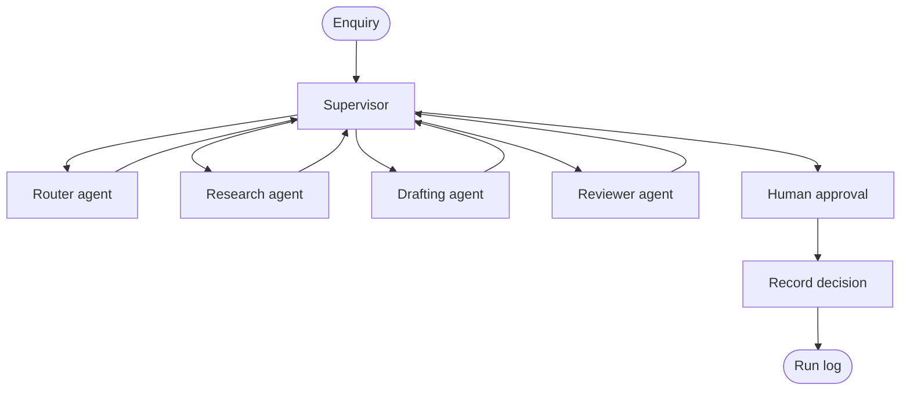
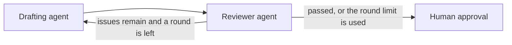

# Enquiry desk

A small, runnable reference demo of a multi agent workflow built with [LangGraph](https://langchain-ai.github.io/langgraph/).

An inbound message for a lettings office is triaged by a router, researched with tools, drafted, reviewed, and held for a person before any outcome is recorded. The default path uses a deterministic stub model, so the demo and the tests run with no API key and no spend. Anthropic Claude and OpenAI are optional.

This is a reference demo designed by Isaac Adekunle (GitHub: [DealEnvoy](https://github.com/DealEnvoy)) and built with AI coding tools. Hale & Quay Lettings, the people, and the listings are fictional. The project has no client deployment, no users, and no production traffic.

## The problem

A small lettings inbox mixes viewing requests, repair reports, tenancy applications, and sales mail. A careless reply can quote a rent that is not on the listing, promise a repair visit that is not booked, or agree to waive a deposit.

Hale & Quay is a fictional independent agency in Bristol. The desk handles one message at a time:

1. A router labels the message.
2. A research agent loads facts from a small catalogue and repair book.
3. A drafting agent writes a reply.
4. A reviewer checks the reply against those facts and a short policy list.
5. A person approves or rejects the result.

The policy notes mention the Tenant Fees Act 2019 because that is the sort of rule a real English letting desk has to respect. The wording in this repo is a short demo summary, not legal advice. The desk records a decision. It does not send email.

## Architecture

The supervisor is ordinary Python in `workflow.py`. It reads the shared state and chooses the next node. The router model classifies the message. It does not choose whether the human checkpoint runs.



If the router, research, drafting, or review node still fails after its retries, an error handler jumps straight to approval. The compiled graph, including those handlers, is printed by:

```bash
python -m enquiry_desk diagram
```

The review loop sits inside the same supervisor. A failed audit goes back to the drafter while a round remains. After the round limit, the case still stops for a person, and the desk will not mark the reply ready to send.



## How the agents share work

`EnquiryState` in `state.py` is the whole case file. Each node returns the fields it changed. LangGraph merges them.

| Field | Who writes it | How it combines |
| --- | --- | --- |
| `intent`, `urgency`, `listing_query` | Router | Replaced |
| `facts`, `research_status` | Research | Replaced |
| `draft`, `draft_version` | Drafter | Latest draft replaced, `drafts` appended |
| `review_passed`, `review_issues` | Reviewer | Replaced. History is appended |
| `approval` | Approval node, after resume | Replaced |
| `outcome` | Finalize | Replaced |
| `trace`, `tool_events`, `usage_events` | Every step | Appended |
| `usage` | Every model call | Summed |

Facts are built from tool results in code (`facts_from_tool_results`). A sentence from the model is not stored as a fact. The drafter is shown those facts. `audit_reply` rejects a `£` amount or a clock time that is not in the fact text, so a rent in the reply has to have come from `get_listing`.

Each agent calls at least one tool:

| Agent | Tools |
| --- | --- |
| Router | `match_intent_hints` |
| Research | `search_listings`, `get_listing`, `get_viewing_slots`, `find_repair` |
| Drafter | `get_policy_snippet` |
| Reviewer | `audit_reply` |
| Finalize | `record_decision` writes `runs/<enquiry_id>.json` |

`search_listings` returns ids and titles only. The rent is on `get_listing`. The research stub tries the property hint as a listing id, gets a clean not-found result, and then searches. That recovery is visible in the sample run below. The sender's email does not contain the rent.

The offline drafter has one scripted mistake. When someone asks to waive a deposit, and there are no review notes yet, the first draft agrees. The reviewer sends it back, and the second draft refuses. A live model is not scripted this way. `audit_reply` still blocks the bad wording, and a passing review is required before an approve can mark the reply ready to send.

The reviewer model writes a one line note. The pass or fail flag comes from `audit_reply`.

## Errors and retries

There are four layers. They fail toward a person, not toward a stack trace.

1. **Tool calls.** `TransientToolError` is tried up to 3 times inside the same node. The attempts are written to `tool_events`. A normal not-found result is not retried. The agent sees it and can call a different tool, which is what happens with the bad listing id. Any other exception from a tool becomes a failed result, so one bug does not drop the rest of the case.
2. **Bad JSON.** The node asks the model again and includes the parse error, up to 2 repairs. A fenced JSON block is accepted. If the output is still unusable, the node raises `ModelOutputError`.
3. **Transient model errors.** The four agent nodes use a LangGraph `RetryPolicy` for `TransientModelError` only, with 3 attempts and no sleep. `ValueError` and `ModelOutputError` are not retried, because the same input would fail again. After the attempts are used, the error handler sets `fatal_error` and routes to approval.
4. **A failed review.** `decide()` sends the case back to the drafter while `draft_version` is below `max_review_rounds` (default 2). After that, approval still runs. `resolve_outcome()` returns `approved_to_send` only when the recommendation is `send` and the person approves. A failed review recommends `escalate`, so an approve records `escalated`.

Reads are safe to repeat. `record_decision` runs once, in `finalize`, after the person has answered, and it overwrites a single file for that enquiry id.

## Approval

Approval calls LangGraph `interrupt()`. The process pauses with the draft, the review, and a recommended action: `send`, `archive`, or `escalate`. Resuming with `approve` or `reject` continues the same node. The node restarts from the top on resume, so it does not write the run log before the interrupt.

The graph needs a checkpointer for that pause. This demo uses `InMemorySaver`, so the pause lives only inside the process. `build_graph(..., checkpointer=...)` accepts another saver if you want the pause to survive a restart.

| Recommendation | Approve | Reject |
| --- | --- | --- |
| `send` (review passed, customer intent) | `approved_to_send` | `withheld` |
| `archive` (spam) | `archived` | `withheld` |
| `escalate` (failed review, unknown intent, or a crashed agent) | `escalated` | `withheld` |

`approved_to_send` means a person may send the reply. Mail delivery is out of scope.

## Tokens and cost

Every model call appends a `usage_events` row and adds to `usage`. The stub estimates tokens as about four characters per token and prices them at zero. A live call uses the token counts on the provider response.

`cost.py` holds a small rate table in USD per 1,000,000 tokens. `stub` is zero. Any other model name uses the `example` row, which is 3 for input and 15 for output. Those are round example figures so a live run can print a number. They are not an invoice. Put your provider's current prices in that table before you treat the figure as anything else. The run log records `rate_label` so you can see which row was used.

Calls that raise before a response, such as a timeout with no usage payload, are absent from the total. Completed calls, including JSON that failed to parse, are included when the node returns or when the error handler keeps them.

## Run it

Python 3.11 or newer.

```bash
python -m venv .venv
source .venv/bin/activate
pip install -e ".[dev]"
python -m enquiry_desk demo
pytest
```

`demo` always uses the stub, including when `ENQUIRY_DESK_MODEL` is set in the environment. It runs `examples/fee-waiver.json` and passes `--decision approve`.

Other messages:

```bash
python -m enquiry_desk run examples/viewing.json --decision approve
python -m enquiry_desk run examples/maintenance.json --decision approve
python -m enquiry_desk run examples/spam.json --decision approve
python -m enquiry_desk run examples/unclear.json --decision approve
```

Leave off `--decision` in a terminal and the desk will ask for `approve` or `reject`. Without a terminal, pass the flag. `--max-review-rounds 1` on the fee waiver example keeps the bad draft and records `escalated` even if you approve.

An API key on its own does nothing. The model stays on the stub until you set `ENQUIRY_DESK_MODEL`.

```bash
pip install -e ".[live]"
export ENQUIRY_DESK_MODEL=anthropic
export ANTHROPIC_API_KEY=your-key
export ANTHROPIC_MODEL=claude-sonnet-4-5   # optional, this is the default
python -m enquiry_desk run examples/viewing.json --model anthropic
```

OpenAI is the same shape: `ENQUIRY_DESK_MODEL=openai`, `OPENAI_API_KEY`, and optional `OPENAI_MODEL` (default `gpt-4.1-mini`). Copy `.env.example` to `.env` for local values. `.env` is gitignored. Do not commit keys.

Confirm the model id with your account before a live run. The defaults are starting points, and a retired id will fail at the provider with a configuration error rather than a silent stub fallback. `--model stub` forces the offline path for one command.

## Sample run

This is the output of `python -m enquiry_desk demo` in this repo. The first draft agrees to waive the deposit on purpose, the audit rejects it, and the second draft uses the rent returned by `get_listing`.

```text
Enquiry desk
Hale & Quay Lettings (fictional agency, demo data)

Enquiry: enq-1044
From: Alex Morgan <alex.morgan@example.com>
Subject: Applying for Queen Square, and the deposit
Model: stub (offline, no API key)

Trace
 1  supervisor  Next is router.
 2  router      match_intent_hints: matched application (apply, waive, deposit)
 3  router      Classified as application, urgency normal. The hint tool matched application from: apply, waive, deposit. Property hint: Queen Square.
 4  supervisor  Next is research.
 5  research    get_listing attempt 1 failed: No listing with id 'queen-square'.
 6  research    search_listings: QS-14-2 Flat 2, 14 Queen Square (available)
 7  research    get_listing: QS-14-2, rent £1,450 pcm
 8  research    The catalogue records this reply needs are loaded. Facts recorded: 1. Status ok.
 9  supervisor  Next is drafter.
10  drafter     get_policy_snippet: topic application
11  drafter     Draft round 1. Offline stub: this first draft deliberately agrees to a deposit waiver so the review loop is visible without an API key.
12  supervisor  Next is reviewer.
13  reviewer    audit_reply: failed, 3 issues
14  reviewer    Review failed. The audit found 3 issue(s).
15  supervisor  Next is drafter.
16  drafter     get_policy_snippet: topic application
17  drafter     Draft round 2. Refused the deposit waiver and used the listing rent.
18  supervisor  Next is reviewer.
19  reviewer    audit_reply: passed
20  reviewer    Review passed. The audit found no issues.
21  supervisor  Next is approval.

Draft round 1
Hello Alex Morgan,

We can waive the deposit so you can move in without one.

Kind regards,
Hale & Quay Lettings

Draft round 2
Hello Alex Morgan,

Thank you for your interest in Flat 2, 14 Queen Square, Bristol, BS1 4QS. The rent is £1,450 pcm. It is available 1 December 2026. We cannot waive the deposit. A holding deposit is capped at one week's rent. Referencing and a Right to Rent check come before any tenancy is offered.

Kind regards,
Hale & Quay Lettings

Review
Round 1 failed. The audit found 3 issue(s). Issues: Banned wording without a clear refusal: 'we can waive'.; Banned wording without a clear refusal: 'waive the deposit'.; Banned wording without a clear refusal: 'move in without one'.
Round 2 passed. The audit found no issues.

Checkpoint
Recommended action: send
A person has to decide before the desk records an outcome.

Tokens: prompt 5899, completion 443, total 6342
Illustrative cost: $0.00. Stub rates are zero. This is not a bill.

Decision: approve
Outcome: approved_to_send
Marked ready to send. Mail delivery is out of scope for this demo.
Run log: runs/enq-1044.json
```

## Tests

`pytest` covers routing, delegation of tool facts into the draft, a missing listing id, transient tool and model failures, invalid JSON, the approval pause, and the rule that a failed review cannot be released. GitHub Actions runs the same suite on Python 3.12 with `ENQUIRY_DESK_MODEL=stub`. No API key is required.

## Add an agent

A scheduler that proposes a viewing slot before the human gate would look like this. The branch has to sit before approval in `decide()`, or the new node never runs.

1. Add any new fields to `EnquiryState` and `initial_state` in `state.py`. A `booking` string is enough for a first version.
2. Add a tool in `tools.py` if the agent needs data the other tools do not already return. Viewing slots are already in `facts` after research, so a first scheduler can read those and skip a new tool.
3. Write a node function next to the others in `nodes.py`. Return a partial state update. Append a trace event.
4. Register it in `build_graph` with the same `RetryPolicy` and `error_handler` as the other agents, and add an edge back to `supervisor`.
5. In `decide()`, return `"scheduler"` when the intent is `viewing`, the review has passed, and `booking` is still empty. Leave the approval branch under that check.
6. Add an example enquiry if you need a new shape of message, and a test that the new node runs before `pause.next` is `("approval",)`.

The same pattern fits a compliance agent or a translation agent. Keep the supervisor in code, keep numbers in tool facts, and keep `interrupt()` in front of anything a person would have to stand behind.

## Layout

```text
src/enquiry_desk/workflow.py   supervisor policy
src/enquiry_desk/graph.py      LangGraph wiring
src/enquiry_desk/nodes.py      agents, approval, finalize
src/enquiry_desk/models.py     stub model and live adapters
src/enquiry_desk/tools.py      catalogue, audit, run log
src/enquiry_desk/state.py      typed shared state
src/enquiry_desk/cost.py       token totals and example rates
examples/                      five fictional enquiries
tests/                         pytest suite
```

## Licence

MIT. Copyright 2026 Isaac Adekunle.
